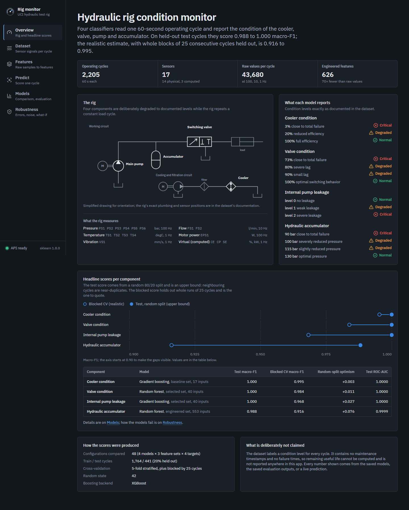
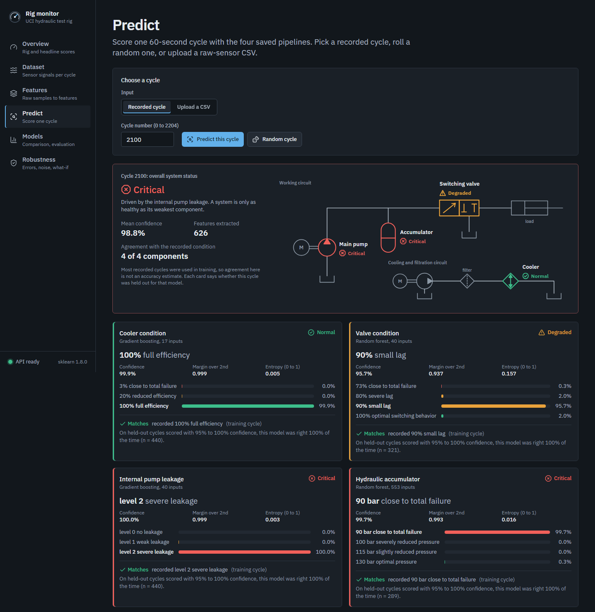

# Predictive Maintenance of Industrial Hydraulic Systems Using Feature Engineering

A condition-monitoring system for a hydraulic test rig, built around **feature
engineering** rather than model tuning. Every number in this README was produced
by running `src/train.py` and `src/evaluate.py` on the UCI *Condition monitoring
of hydraulic systems* dataset.

**Stack:** Python feature engineering + scikit-learn/XGBoost pipelines, served by a FastAPI API,
with a React + TypeScript dashboard (Vite, Tailwind CSS, shadcn/ui).





---

## Abstract

A hydraulic power unit repeats a 60-second constant-load cycle while 17 sensors
record pressures, flows, temperatures, motor power and vibration. Across 2,205
such cycles, four components — cooler, valve, pump and hydraulic accumulator —
are set to known degradation levels. One cycle contains **43,680 raw samples**,
which is far more columns than there are cycles, and the three sampling rates
(100 Hz, 10 Hz, 1 Hz) mean the channels are not even time-aligned sample for
sample.

This project compresses each cycle into **626 engineered features** — a 70×
reduction — organised into five blocks: statistical, time-domain, rolling/local,
frequency-domain, and hydraulic domain-specific. Three experiments (baseline,
engineered, selected) are run across four classifiers for each of the four
components, inside leakage-safe scikit-learn pipelines. Engineered features
raise cross-validated macro F1 by **+0.024 on the valve** and **+0.022 on the
accumulator** over a per-sensor-mean baseline, and lift SVM on the valve target
from 0.53 to 0.99. On the untouched test set the final models reach **100 %
macro F1 for cooler, valve and pump**, and **98.8 % for the accumulator**.

Remaining Useful Life is **not** estimated: the dataset provides condition
levels, not maintenance timestamps or failure times.

---

## Problem statement

Unplanned hydraulic failures stop whatever production line the unit feeds.
Scheduled maintenance is wasteful (parts replaced while still healthy) and still
misses faults that develop between services. Condition monitoring reads the
machine's own signals and reports component health continuously.

**Research question.** Can engineered statistical, temporal, frequency-domain and
hydraulic domain-specific features extracted from sensor signals improve
machine-learning-based condition monitoring, compared with a naive cycle
summary?

---

## Objectives

1. Inspect the dataset from its own files and documentation, assuming nothing.
2. Compress each 60-second cycle into an interpretable feature vector.
3. Quantify what each feature-engineering block contributes.
4. Predict cooler, valve, pump-leakage and accumulator condition.
5. Prevent data leakage structurally, not by discipline.
6. Deliver a dashboard that scores a single cycle using the saved pipelines.

---

## Dataset

**UCI / ZeMA gGmbH, Saarbrücken — Condition monitoring of hydraulic systems.**
Download it from https://archive.ics.uci.edu/dataset/447/condition+monitoring+of+hydraulic+systems
(CC BY 4.0, ZeMA gGmbH; also mirrored at https://doi.org/10.5281/zenodo.1323611).
Place the extracted files directly in `data/raw/` (`PS1.txt … profile.txt`).

| Property | Value |
|---|---|
| Operating cycles | 2,205 |
| Cycle duration | 60 s, constant load |
| Sensors | 17 |
| Raw dimensions per cycle | 43,680 |
| Total raw values | 96,314,400 |
| Missing values | none (confirmed by the feature-quality audit) |

Each sensor file is a tab-delimited matrix: **rows are cycles, columns are
samples within the cycle**.

### Sensor description

| Sensor | Quantity | Unit | Rate | Samples/cycle |
|---|---|---|---|---|
| PS1–PS6 | Pressure | bar | 100 Hz | 6000 |
| EPS1 | Motor power | W | 100 Hz | 6000 |
| FS1, FS2 | Volume flow | l/min | 10 Hz | 600 |
| TS1–TS4 | Temperature | °C | 1 Hz | 60 |
| VS1 | Vibration | mm/s | 1 Hz | 60 |
| CE | Cooling efficiency *(virtual)* | % | 1 Hz | 60 |
| CP | Cooling power *(virtual)* | kW | 1 Hz | 60 |
| SE | Efficiency factor *(virtual)* | % | 1 Hz | 60 |

CE, CP and SE are computed by the rig rather than measured, so features built on
them inherit the rig's own model — noted as a limitation.

### Targets (`profile.txt`, exactly as documented)

| Component | Levels | Class counts |
|---|---|---|
| Cooler condition [%] | 3 = close to total failure, 20 = reduced efficiency, 100 = full efficiency | 732 / 732 / 741 |
| Valve condition [%] | 73 = close to total failure, 80 = severe lag, 90 = small lag, 100 = optimal | 360 / 360 / 360 / 1125 |
| Internal pump leakage | 0 = none, 1 = weak, 2 = severe | 1221 / 492 / 492 |
| Accumulator [bar] | 90 = close to total failure, 100 = severely reduced, 115 = slightly reduced, 130 = optimal | 808 / 399 / 399 / 599 |

Column 5, the **stable flag**, describes the rig's state rather than a
component's health, so it is kept as metadata and not modelled.

---

## Feature engineering

One row of the engineered dataset = one complete operating cycle.

| Block | Features | What it captures |
|---|---|---|
| Statistical | 251 | Distribution shape: mean, median, std, variance, min, max, range, RMS, MAV, skewness, kurtosis, quartiles, IQR, coefficient of variation |
| Time-domain | 162 | Peak-to-peak, peak amplitude, signal energy, first-difference statistics, linear slope, zero crossings, peak count |
| Rolling / local | 54 | 1-second moving mean and moving std, then summarised — window length derived from each sensor's own sampling rate |
| Frequency-domain | 63 | Dominant frequency, spectral energy, spectral centroid, log-spaced band energy ratios |
| Hydraulic domain | 96 | Pressure differentials and ratios, flow imbalance, hydraulic power, electro-hydraulic efficiency, specific power, temperature spreads, cooling conductance, vibration per unit power |
| **Total generated** | **626** | → **553 after cleaning** (4 constant, 4 near-zero variance, 65 duplicates removed) |

### Design decisions worth defending in a viva

- **Windows and FFTs are sampling-rate aware.** A 1-second rolling window is 100
  samples on a pressure channel and 1 sample on a temperature channel, so
  rolling and spectral features are generated **only for ≥10 Hz channels**. A
  60-point 1 Hz signal has a 0.5 Hz Nyquist limit; an FFT of it describes
  nothing.
- **FFT bands are log-spaced.** The load programme repeats at ~0.033 Hz, so
  nearly all energy sits below 1 Hz. Linear bands over 0–50 Hz put ~100 % of the
  energy in band 1 and produced constant zeros; log spacing resolves the region
  where the hydraulics actually live.
- **Only a handful of spectral features per channel.** A full 6000-point
  spectrum has 3001 bins; using them all would add ~21,000 columns and recreate
  the p ≫ n problem feature engineering exists to solve.
- **Domain features are justified from units alone.** The documentation gives
  each channel's physical quantity and unit but not the rig's piping topology,
  so no feature assumes internal circuit layout. Hydraulic power uses
  P[kW] = p[bar]·Q[l/min]/600; efficiency divides it by EPS1; flow imbalance
  FS1−FS2 is the direct physical signature of internal pump leakage.
- **Coefficient of variation is skipped for temperature.** °C has an arbitrary
  zero, so a CV of a Celsius reading has no physical meaning.
- **Every division is guarded.** `safe_divide` returns a finite fill value where
  a denominator approaches zero. The engineered table contains **zero** infinite
  or missing cells.

---

## Machine learning

| Model | Why it is included |
|---|---|
| Logistic Regression | Linear reference point; if a line already separates the classes, complexity is unjustified |
| Random Forest | Non-linear, handles interactions, gives an interpretable importance ranking |
| XGBoost | Usually the strongest tabular learner; falls back to `HistGradientBoostingClassifier` if unavailable |
| SVM (RBF) | A different inductive bias from the trees — a check that results are not a tree artefact |

No deep learning: 2,205 samples with a few hundred engineered features is exactly
the regime where gradient-boosted trees dominate, and a neural network would
sacrifice the interpretability a maintenance system needs.

**Class imbalance** is mild (worst ratio ≈ 3.1:1). Class weighting is applied
where the ratio exceeds 1.5. **SMOTE is deliberately not used**: the classes are
ordered degradation levels, so interpolating between "weak leakage" and "severe
leakage" would manufacture cycles the rig never produced, precisely where the
decision boundary is hardest.

---

## Experimental design

- **Split:** 80 % train / 20 % test, stratified per component target.
- **Model selection:** 5-fold stratified cross-validation **on the training set
  only**.
- **Selection rule, fixed in advance:** highest mean cross-validated **macro
  F1** — it weights every class equally, so a model cannot score well by
  ignoring a rare but operationally critical failure state.
- **Test set touched exactly once**, in `evaluate.py`.

### How leakage is prevented structurally

Imputation, scaling, correlation filtering, mutual-information ranking and tree
importance are all **stages of one `sklearn.pipeline.Pipeline`**. Only that
object is passed to `cross_val_score`/`fit`, so scikit-learn re-fits every stage
on each training fold. Leaking by accident is impossible. The only pre-split
step is the removal of constant/duplicate columns, which is a label-free schema
decision.

### Why there is no chronological split

The conditions were varied as a *designed sequence*, not interleaved randomly.
Checked directly: **the last 20 % of cycles contain only cooler class 100**. A
chronological holdout leaves entire classes untestable, so stratified splitting
is the only workable protocol.

Because neighbouring cycles were recorded moments apart under the same setting,
a random split can still be mildly optimistic. This is quantified with
`StratifiedGroupKFold` over **contiguous 25-cycle blocks**, so a cycle is never
scored while its immediate neighbours sit in training.

### Three experiments

| Experiment | Representation |
|---|---|
| baseline | per-sensor cycle mean (17 features) |
| engineered | all 553 cleaned engineered features |
| selected | engineered → correlation filter (\|r\| > 0.95) → mutual information (top 50 %) → Random Forest importance (top 40) |

---

## Results

### Does feature engineering help? (best cross-validated macro F1)

| Component | baseline | engineered | selected | engineered − baseline | selected − baseline |
|---|---|---|---|---|---|
| Accumulator | 0.9706 | 0.9922 | 0.9911 | **+0.0216** | **+0.0206** |
| Cooler | 0.9983 | 0.9977 | 0.9983 | −0.0006 | −0.0000 |
| Pump | 0.9906 | 0.9946 | 0.9954 | +0.0039 | +0.0048 |
| Valve | 0.9682 | 0.9925 | 0.9946 | **+0.0243** | **+0.0263** |

The cooler is solvable from cycle means alone — the cooling channels separate the
classes almost linearly — so engineering adds nothing there, and saying so is
more useful than pretending otherwise. The gains concentrate exactly where the
documentation says the hard targets are: **valve and accumulator**.

Feature *selection* matters most for the weaker learners. On the valve target,
SVM goes **0.53 → 0.95 → 0.99** across baseline → engineered → selected, and
Logistic Regression **0.96 → 0.99**: removing redundant, collinear features is
what makes margin- and coefficient-based models competitive with the trees.

### Final test-set results (each evaluated exactly once)

| Component | Model | Feature set | Accuracy | Macro F1 | Weighted F1 | ROC-AUC (OvR) | Features used |
|---|---|---|---|---|---|---|---|
| Cooler condition | XGBoost | baseline | 1.0000 | 1.0000 | 1.0000 | 1.0000 | 17 |
| Valve condition | Random Forest | selected | 1.0000 | 1.0000 | 1.0000 | 1.0000 | 40 |
| Internal pump leakage | XGBoost | selected | 1.0000 | 1.0000 | 1.0000 | 1.0000 | 40 |
| Hydraulic accumulator | Random Forest | engineered | 0.9887 | 0.9881 | 0.9886 | 0.9999 | 553 |

### Leakage check (macro F1)

| Component | CV, random folds | Test, random split | Temporal-block CV | Optimism |
|---|---|---|---|---|
| Cooler | 0.9983 | 1.0000 | 0.9954 | +0.0029 |
| Valve | 0.9946 | 1.0000 | 0.9839 | +0.0107 |
| Pump | 0.9954 | 1.0000 | 0.9683 | +0.0271 |
| Accumulator | 0.9922 | 0.9887 | 0.9161 | +0.0761 |

The accumulator gap is the honest headline: roughly **7–8 points** of its
apparent performance comes from temporal proximity between train and test
cycles. Reporting only the random-split number would overstate what the system
would do on a freshly recorded cycle.

### Most important features (sanity check against the physics)

| Component | Top features | Physically sensible? |
|---|---|---|
| Cooler | `PS6_mean`, `CE_mean`, `CP_mean` | Yes — cooling efficiency and cooling power channels |
| Valve | `PS2_cv`, `PS2_band3_energy_ratio`, `PS2_max_abs_change` | Yes — switching lag shows as pressure variability and high-band spectral content |
| Pump | `FS1_q75`, `FS1_rms`, `EPS1_max` | Yes — internal leakage changes delivered flow and the power needed to produce it |
| Accumulator | `PS3_rollmean_max`, `PS3_rollmean_range`, `PS1_band3_energy_ratio` | Yes — a discharged accumulator damps pressure transients less |

Full tables: `outputs/reports/model_comparison.md`, `outputs/metrics/*.csv`.

---

## Dashboard

`streamlit run app.py` — five tabs covering the six required sections:

1. **Overview** — predictive maintenance, the rig, why feature engineering.
2. **Dataset explorer** — cycles, sensors, sampling frequencies, condition
   distributions with imbalance ratios.
3. **Feature engineering** — raw dimensions, feature counts by block, cleaning
   losses, selected features per component.
4. **Predict & status** — pick a dataset cycle **or** upload a raw-sensor CSV →
   features extracted → saved pipeline applied → per-component condition,
   Normal/Degraded/Critical cards and class probabilities.
5. **Results** — the full experiment grid and test metrics.

The Normal/Degraded/Critical wording maps one-to-one onto the dataset's own
documented levels. No industrial thresholds are invented.

**The dashboard never retrains.** It loads `models/<component>/model.joblib`,
which already contains the fitted imputer, scaler and selectors.

---

## Installation

```bash
git clone <your-repo-url>
cd hydraulic_predictive_maintenance
python -m venv .venv && source .venv/bin/activate    # Windows: .venv\Scripts\activate
pip install -r requirements.txt
```

Extract the UCI dataset so that `PS1.txt … profile.txt` sit directly inside
`data/raw/`.

## How to run

```bash
python src/data_loader.py    # optional: dataset inspection only
python src/train.py          # feature engineering, 48 experiments, model selection
python src/evaluate.py       # single test-set evaluation + figures + report
streamlit run app.py         # dashboard
```

`train.py` accepts `--component valve` to run one component at a time and resume
after an interruption. Full run: roughly 15–20 minutes on a single CPU core.

## How to run the web app (Windows, PowerShell)

The web app replaces the two Streamlit dashboards with a FastAPI service
(`api/`, a thin wrapper around `src/`) and a React frontend (`frontend/`). It
never trains anything: it loads the saved models and reads `outputs/`.

**Prerequisites.** Python 3.11 or newer (the saved models were pickled with
scikit-learn 1.8.0, which needs it), Node.js 20 or newer, the trained `models/`
and `outputs/` folders, and the raw data in `data/raw/`.

**1. One-time setup**, from the project root:

```powershell
# Python environment. If `py -3.12` is not available, install uv
# (`python -m pip install uv`) and use: uv python install 3.12; uv venv .venv --python 3.12
py -3.12 -m venv .venv
.\.venv\Scripts\Activate.ps1
python -m pip install -r requirements-dev.txt    # requirements.txt + pytest/httpx

# Frontend dependencies
cd frontend
npm install
cd ..
```

If PowerShell refuses to run `Activate.ps1`, allow local scripts once with
`Set-ExecutionPolicy -Scope CurrentUser RemoteSigned`. The pipeline commands
above (`python src/train.py`, `python src/evaluate.py`) work unchanged inside
this environment.

**2. Start the API** (terminal 1, project root, venv active):

```powershell
uvicorn api.main:app --port 8000
```

It answers immediately and loads the models in the background (about 3 s).
Check it at <http://127.0.0.1:8000/api/health> or browse the endpoints at
<http://127.0.0.1:8000/docs>. Endpoint shapes are documented in `api/README.md`.

**3. Start the frontend** (terminal 2):

```powershell
cd frontend
npm run dev
```

Open <http://localhost:5173>. Vite forwards `/api` to port 8000. While the API
is warming up the app shows a "Loading models" screen, and if the API is not
running it says so and reconnects on its own.

**Tests and production build:**

```powershell
python -m pytest api/tests -q          # API tests (project root, venv active)
cd frontend
npm run typecheck                      # TypeScript strict
npm run build                          # production bundle in frontend/dist
npm run preview                        # serves dist on http://localhost:4173, /api proxied to 8000
```

`streamlit run app.py` and `streamlit run MLapp.py` still work while the web
app reaches full parity.

## Project structure

```
hydraulic_predictive_maintenance/
    data/raw/                    the extracted UCI dataset (not in the repo)
    data/processed/              baseline feature table, cached labels
    notebooks/                   01 exploration, 02 features, 03 training, 04 evaluation
    src/
        utils.py                 paths, seed, safe division, IO helpers
        data_loader.py           sensor specs, label definitions, dataset summary
        preprocessing.py         quality report, cleaning, class-balance policy
        feature_engineering.py   the five feature blocks
        feature_selection.py     correlation / MI / tree-importance transformers
        models.py                classifier definitions + balanced XGBoost wrapper
        train.py                 experiments, selection, persistence
        evaluate.py              test evaluation, figures, markdown report
        prediction.py            single-cycle inference API
        visualization.py         every figure
    models/<component>/          model.joblib, label_encoder.joblib, metadata.json, split_indices.npz
    outputs/figures/             45 figures
    outputs/metrics/             model_results.csv, test_results.csv, feature_importance.csv
    outputs/reports/             model_comparison.md, feature_quality_report.csv, classification reports
    outputs/features/            engineered_features.csv, selected_features.csv
    api/                         FastAPI service for the web app (README, schemas, tests)
    frontend/                    React + Vite + TypeScript web app (DESIGN.md has the design system)
    app.py, MLapp.py             Streamlit dashboards (kept until the web app reaches parity)
    requirements.txt, requirements-dev.txt
```

## Reproducibility

`RANDOM_STATE = 42` throughout — split, CV shuffling, tree construction,
permutation importance. Saved per component: the fitted pipeline (preprocessing
+ selection + classifier), label encoder, input feature column list, selected
feature names, class/severity maps and train/test indices.

## Limitations

- **No Remaining Useful Life.** Condition levels only; no maintenance timestamps
  or failure times.
- **One rig, one load programme, induced faults.** Transfer to a different
  installation is untested.
- **Temporal correlation inflates random-split scores** by up to ~0.08 macro F1
  on the accumulator, as quantified above.
- **A chronological split is impossible** on this dataset (single-class tail).
- **Degradation is discrete here, continuous in reality**, and several faults are
  active in the same cycle.
- **CE, CP, SE are virtual channels**, already derived by the rig.
- **Impurity importance is biased** towards continuous, high-cardinality
  features; the permutation importances in `outputs/figures/feature_importance/`
  are the more trustworthy ranking.
- **Near-ceiling scores limit discrimination.** With three targets at 100 % test
  macro F1, differences between models are within noise — which is itself a
  finding: the engineered representation makes these targets easy.

## Future work

- Validate on a second rig or a different load programme to test transferability.
- Treat the ordered condition levels as **ordinal** rather than nominal, so that
  confusing optimal with total failure is penalised more than confusing adjacent
  levels.
- Model the **joint** component state instead of four independent classifiers,
  since faults interact through the shared oil circuit.
- Add SHAP values for per-cycle local explanations (kept optional here).
- Explore automatic feature extraction/selection (ALA, RFE-SVM) as used by
  Schneider et al. for comparison with the hand-designed blocks.
- Stream inference on live sensor data with drift monitoring on the feature
  distributions.

## Citation

Nikolai Helwig, Eliseo Pignanelli, Andreas Schütze, *Condition Monitoring of a
Complex Hydraulic System Using Multivariate Statistics*, Proc. I2MTC-2015, Pisa,
Italy, 2015. doi: 10.1109/I2MTC.2015.7151267
